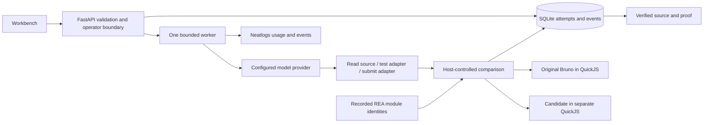

# Architecture and extension boundaries

`main.py` owns input validation, operator access, origin/CSRF/body boundaries, routes and lifecycle. `store.py` owns short SQLite transactions, durable states, idempotency and restart recovery. `service.py` owns the bounded tool loop, cancellation, provider transport and tracing. `engine.mjs` owns artifact identity, isolated execution, generated cases and output/mutation comparison. Native frontend modules consume the API; they cannot accept a repair themselves.

## Trust boundaries

The model receives selected code and counterexamples as data. Its only tools read two allowlisted source modules, compare a candidate and submit one. It cannot replace the archive, generator, interpreter or verifier through those tools. Both interpreter contexts have 64 MB guest memory, a 1 MB stack and three-second evaluation interrupts. The parent verifier has a 65-second process limit and does not inherit provider secrets. No process, require or fetch binding is exposed to the candidate. This bounds the supported execution; it is not an audited operating-system sandbox against interpreter vulnerabilities.

The original archive must match its pinned digest on every verifier invocation. Reference code runs with inert deterministic capabilities only: `crypto.subtle` exists without an implementation and Buffer's JSON-only type predicate returns false. Random/auth/binary contracts are excluded. Original execution errors become Needs review rather than fabricated reference output. Candidate errors become counterexamples. Return values and the complete mutated input are compared after canonicalizing object key order. Array order and types remain significant.

Fresh generation uses a host-selected seed after submission. Before and after face the same inputs. The model never receives that seed during repair. Inputs change names and values within sixteen request or ten interpolation categories; they do not establish equivalence on every possible value or unseen behavior. A deliberate adapter can still overfit those categories. Downloaded evidence states that limit.

## Durable state

Queued → Verifying or Repairing → Verified, Mismatch, Needs review or Failed. Any active state can become Cancelled. Cancellation wins over late updates. Restart marks unfinished attempts Interrupted and requires an explicit new attempt. Only a completed host comparison and matching source digest unlock adapter export. Recorded successful acceptance runs can be inspected but need a new local verification before export.

Repair creates a child run, preserving the parent. The idempotency transaction binds operation key, input digest and parent. Active work is process-local with one worker and a five-attempt ceiling. SQLite records are durable; in-flight model calls are not resumed. Scaling requires a real leased durable job queue and tenant-aware storage, not additional Uvicorn workers against this file.

## Replace components deliberately

- Provider: change the configured compatible chat-completions endpoint, model and private key. Function-tool support is required. DeepSeek uses explicit non-thinking mode; other provider capabilities need their own validation.
- Reference app/version: pin new archive and module digests, analyze source identities, implement a verified oracle, and add both positive and deliberately wrong controls. Changing a name in configuration is insufficient.
- Contract: add actual generated behavior categories, unsupported conditions, original execution and mutation semantics. Keep each extension's claims scoped to its own evidence.
- Frontend: the API and downloadable adapter have no frontend build/runtime dependency. Follow `DESIGN.md` when adding screens.
- Export: the generated adapter is dependency-free JavaScript with Bruno's complete upstream MIT notice. Pair it with the proof; it is experimental compatibility code, not a guaranteed full replacement for Bruno.

REA 6.4.0 supplies static evidence, QuickJS 0.32.0 supplies guest execution, and Bruno supplies expected behavior. The original seven-file analysis is partial. `app/evidence/rea-selection.json` preserves two actual module records and the full parent record digest, graph ID and limitations; it does not reconstruct omitted nodes or imply execution of static edges. Entire Graph's product search is working-tree review evidence; its output names the then-current parent Git commit. It is not a captured Entire checkpoint.
