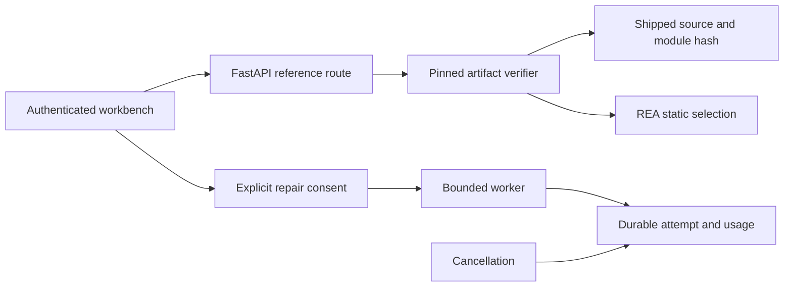

# Backend workbench improvements

## Context

The interface needs inspectable evidence from the actual downloaded Bruno release, and its repair controls must preserve operator consent and honest measurements even when a worker or an in-flight request is interrupted. This pass stays within the existing single-process FastAPI/SQLite application and bounded verifier.

## Resulting behavior

- `GET /api/v1/reference/{contract}` accepts only `request` and `string`. The names map to `src/ipc/network/interpolate-vars.js` and `src/ipc/network/interpolate-string.js` inside the pinned Bruno 4.2.1 archive. It returns the agreed source, module and archive fingerprints, and existing REA selection metadata. The source authority is `shipped original source`; the graph retains `static inference` and its limitations.
- The existing engine checks archive fingerprint `fe9b4c89660ac3f1291707746f76b9b5850edda368a5e0250055687ab02ec767` before extraction. The route additionally checks that the returned source hashes to the declared module fingerprint and that the selected graph node has the same fingerprint. Unsupported module selectors return 422. Missing, changed or inconsistent verifier evidence returns a constrained 503 without raw diagnostics or source content.
- Both new live attempts and repair-from-attempt require `send_data: true`, including attempts without a custom input. Rejected consent does not create a run or enqueue work. Consent does not bypass server model-key readiness.
- History summaries add `kind`, `parent_id`, `passed`, `total`, `model_calls` and `tokens` through one SQLite projection. They do not return source, custom case payloads or events. Missing measurements are null. A review with fewer compared cases than its declared total also reports null comparison counts, covering both unsupported-input skips and partial original-execution failures.
- An executor rejection releases its job reservation, persists the failed attempt and an event, and responds with 503. Capacity rejection remains 429. Retrying the same idempotency key returns the preserved attempt; recovery requires a new attempt, so a failed enqueue cannot silently repeat paid work.
- Cancellation continues to protect state, source, baseline and result. Only `model_calls`, `total_tokens`, `usage` and `trace_delivery` may be updated afterward, so a measured response from an already in-flight provider call remains visible without accepting its repair.
- The repair route is synchronous so FastAPI executes its SQLite work in the thread pool. The new reference route is also synchronous; archive hashing, extraction and graph inspection do not run on the async event loop.

## Four-pass review

1. **Implementation:** Kept the declared API shape and existing bounded worker. Added no service, framework, database migration or dependency.
2. **Expert review:** Reviewed authentication, fixed module selection, error disclosure, idempotency and worker reservations. The reference route inherits existing API authentication before invoking the verifier. Main repair consent now checks every live entry point.
3. **Refutation:** Added negative checks for unsupported selectors, failed verification, altered module digests, unauthenticated reference access, consent omission, six consecutive rejected worker submissions, and cancellation during a mocked provider response. Follow-up reviews identified that skipped and partially executed reviews' fixture totals were not complete measured results; the history projection now withholds those counts. The partial-execution control is explicitly synthetic, shaped like the engine's original-execution failure response.
4. **Polish:** Retained separate shipped-source and static-graph authority labels, constrained recoverable messages, and the narrow cancellation measurement whitelist. Existing browser CSP, exports, mutation comparison and independent fresh-input submission controls remain covered by the original suite.

## Validation evidence

Ran the already-approved `.venv/bin/python -m unittest discover -s tests -v` after all backend changes, including the final partial-review refinement: **19 tests passed in 14.389 seconds**, exit 0. The first expanded run had 18 passing tests; the final run includes skipped and partially executed review history truthfulness.

| Observation | Evidence boundary |
| --- | --- |
| Both reference modules expose actual source, archive fingerprint, recomputed module hash and matching REA node identity | Real downloaded artifact and local engine execution |
| Local string verification passes 40/40; export and durable history remain valid | Real local verifier, zero model calls |
| Invalid artifact response and module digest are withheld with 503 | Explicit mocked failure controls |
| Missing repair consent creates no attempt and starts no worker | HTTP controls with enqueue mocked; no paid call |
| Stopped executor does not leave phantom jobs and its failed attempt remains durable | Real stopped executor and SQLite |
| Skipped or partially completed oracle reviews do not present complete comparison measurements | Real unsupported-contract result plus explicit partial-execution negative fixture |
| Cancelled response retains one call and 17 tokens while rejecting its late source | Synthetic provider usage, local protocol control; no claim of real billing or remote tracing |
| Unknown fields, cross-origin/CSRF requests, remote unauthenticated clients and premature adapter exports remain rejected | Existing HTTP boundary checks |
| Infinite guest, input mutation, wrong final submission and unsupported contracts remain bounded/withheld | Existing real engine controls plus mocked submission |

Tests use temporary databases, disable Neatlogs exporting and mock provider transport. No paid calls, new credentials, cloud resources, public deployment or server restart were performed by this leaf.

## Trade-offs and assumptions

Reference inspection runs existing verifier processes on demand, preserving the current fingerprint boundary at the cost of local extraction work. This is appropriate for the current authenticated operator app; it is not a public source-serving service. History remains bounded to the newest 100 attempts. SQLite JSON projection assumes the JSON functions available in the repository's Python runtime; the passing suite exercises that runtime. Cancellation cannot undo an already in-flight provider request, and its usage is only known once a response supplies measurements. The product's finite Bruno contracts remain the scope of verification.

## Open questions

None required for this leaf. Root still needs to restart the local app, independently reverify the returned backend work and perform integrated browser checks.
